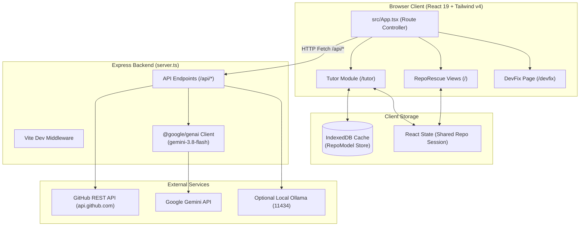

# Developer Onboarding Guide: RepoRescue

*Welcome to the RepoRescue codebase! This guide is formatted according to the RepoTutor specification to help you understand the architecture, run the system locally, and make your first pull request.*

---

## 1. Executive Overview

**RepoRescue** is a full-stack developer productivity application combining three complementary developer workflows:
1. **RepoRescue Core:** AI-powered repository health diagnostics, code complexity analysis, test coverage evaluation, and contributor task mapping.
2. **Tutor:** An interactive onboarding copilot that parses repositories into structured `RepoModel` representations, renders Mermaid diagrams, guides developers through step-by-step reading tours, answers questions with verified citation chips, and exports `ONBOARDING.md`.
3. **DevFix:** A dedicated error diagnostic and automated repair engine that resolves compiler and runtime bugs across 12+ programming languages.

**Target Audience:** Full-stack engineers, open-source maintainers, and developer tooling contributors.

---

## 2. Tech Stack & Key Dependencies

| Technology | Category | Why Used |
| :--- | :--- | :--- |
| **TypeScript 5.8** | Language | Strict type definitions across frontend components and backend Express routes. |
| **React 19** | Frontend Framework | Component-based UI with modern hooks and state management. |
| **Vite 6** | Build Tooling | Lightning-fast HMR and ESM bundling with integrated dev server middleware. |
| **Tailwind CSS v4** | Styling | Ultra-fast utility styling via `@tailwindcss/vite` without CSS bloat. |
| **Express 4.21** | Backend Framework | Server-side proxy for GitHub API requests and server-side Gemini AI generation. |
| **@google/genai 2.4** | AI SDK | Modern official Google Gen AI SDK utilizing `gemini-3.8-flash`. |
| **Mermaid 12.2** | Diagrams | Client-side vector diagram rendering for flowcharts, dependencies, and sequence flows. |
| **Vitest 5.0** | Unit Testing | Fast in-memory unit test runner for file filtering, citation guards, and diagram helpers. |
| **Lucide React** | Icons | Crisp, lightweight icons across dashboard controls and navigation menus. |

---

## 3. System Architecture & Entry Points

### Key Entry Points

- `server.ts`: Full-stack backend entry point. Configures Express, mounts Vite dev middleware in development (or serves `dist/` in production), and handles `/api/github/*`, `/api/ai/*`, `/api/tutor/*`, and `/api/devfix/*`.
- `src/main.tsx`: Client-side React DOM mount point (`ReactDOM.createRoot`).
- `src/App.tsx`: Central application shell managing routing between RepoRescue (`/`), DevFix (`/devfix`), and Tutor (`/tutor`, `/tutor/:owner/:repo`).
- `src/features/tutor/components/TutorPage.tsx`: Top-level controller for the Tutor feature module.

### Architecture Diagram



---

## 4. Local Development Setup

### Step 1: Install Dependencies
```bash
npm install
```

### Step 2: Environment Configuration (Optional)
```bash
cp .env.example .env
```
*Note: If `GEMINI_API_KEY` is omitted, the application automatically uses built-in heuristic models for RepoRescue, Tutor, and DevFix.*

### Step 3: Run the Test Suite
```bash
npm test
```
All unit tests should pass with 100% green status.

### Step 4: Start the Dev Server
```bash
npm run dev
```
Open [http://localhost:3000](http://localhost:3000).

---

## 5. Recommended Codebase Reading Tour

1. **`src/types.ts` & `src/features/tutor/types/index.ts`** (~5 mins)
   - Read the core interfaces: `RepoAnalysisData`, `RepoModel`, `TourStep`, `Citation`.
2. **`src/App.tsx`** (~7 mins)
   - Understand how URL routing operates using browser `history.pushState` and `popstate` listeners.
   - Observe how `currentRepo` is shared between RepoRescue and Tutor.
3. **`src/features/tutor/utils/citationGuard.ts`** (~5 mins)
   - Learn how LLM citations are guarded against phantom file hallucination.
4. **`src/features/tutor/utils/mermaidHelper.ts`** (~4 mins)
   - Understand how Mermaid syntax is sanitized and auto-repaired.
5. **`server.ts`** (~8 mins)
   - Inspect the Express routes: `/api/tutor/analyze`, `/api/tutor/chat`, `/api/devfix/analyze`.

---

## 6. Code Conventions & Rules

- **Client vs Server Boundary:** Never import `@google/genai` in frontend components. All AI calls must pass through `/api/*` Express endpoints.
- **Dark Theme Discipline:** Maintain the existing dark palette (`#050505` canvas, `#0a0a0a` panels, `#111` cards, emerald-400 accents).
- **Single Line Affordances:** Action labels, tabs, and nav items must use `whitespace-nowrap shrink-0` to avoid broken wrapping.
- **Error Resiliency:** Every AI endpoint must have a graceful heuristic fallback so that network drops or quota exhaustion never crash the UI.
